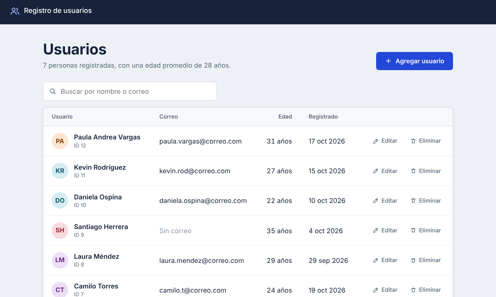
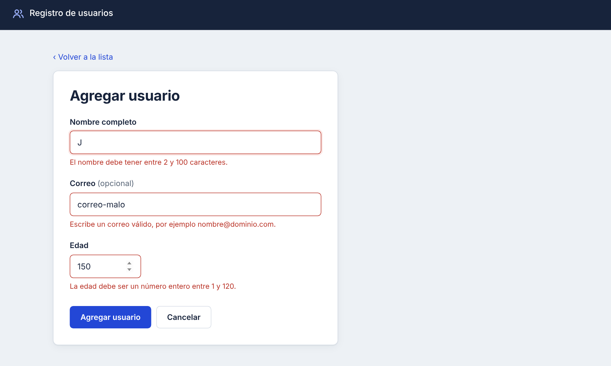
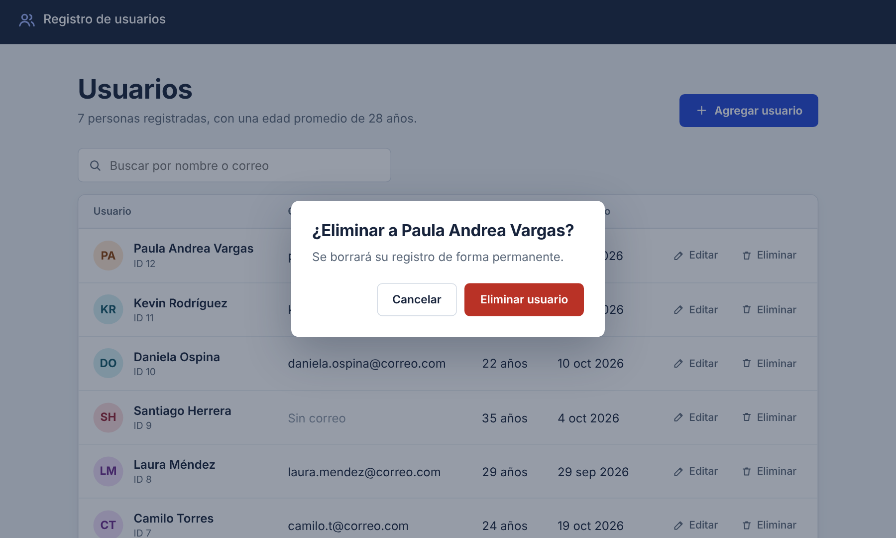
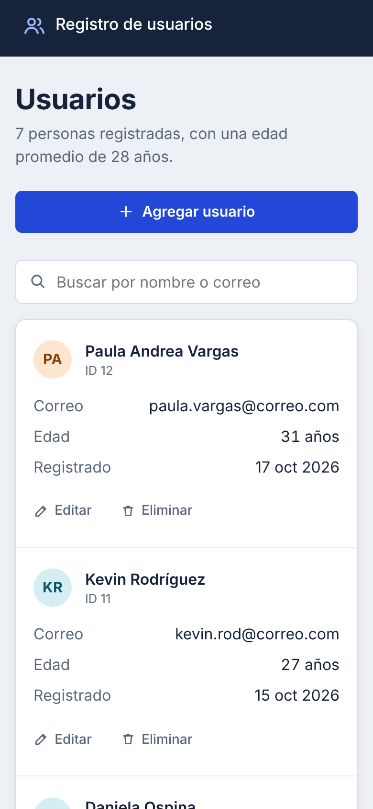

# Registro de usuarios: CRUD en PHP y PostgreSQL

Aplicación web para registrar, consultar, editar y eliminar usuarios. Está hecha con PHP puro (sin frameworks), PostgreSQL, HTML, CSS y JavaScript, con énfasis en seguridad, validación de datos y una interfaz clara que funciona en computador y en celular.



## Funcionalidades

- **CRUD completo**: agregar, ver la ficha de cada usuario, editar y eliminar.
- **Buscador** por nombre o correo, sin distinguir mayúsculas.
- **Paginación** de 8 usuarios por página.
- **Validaciones en el servidor** con mensajes claros junto a cada campo: nombre obligatorio, correo con formato válido y sin repetir, edad entre 1 y 120.
- **Confirmación antes de eliminar** con una ventana modal.
- **Mensajes de resultado** después de cada acción ("Juliana Rojas se agregó al registro").
- **Diseño adaptable**: en celular la tabla se convierte en tarjetas.
- **Resumen** con el total de personas registradas y la edad promedio.

## Seguridad

| Riesgo | Cómo se previene |
| --- | --- |
| Inyección SQL | Todas las consultas usan `pg_query_params` (consultas preparadas); los datos nunca se pegan dentro del SQL. |
| XSS (código malicioso en los datos) | Todo lo que se muestra pasa por `htmlspecialchars` mediante la función `e()`. |
| CSRF (envío de formularios desde otro sitio) | Cada formulario lleva un token único por sesión que se verifica en el servidor. |
| Borrado por accidente o por enlace | Eliminar solo funciona por `POST`, con token y confirmación. |
| Contraseña expuesta | Las credenciales viven en `config.php`, que está en `.gitignore` y nunca se sube al repositorio. |

## Capturas

| Validaciones | Confirmar eliminación |
| --- | --- |
|  |  |



## Tecnologías

- PHP 7.4 o superior (probado con PHP 8.3)
- PostgreSQL
- HTML5, CSS3 (variables, grid, flexbox) y JavaScript sin librerías
- XAMPP como servidor local (Apache)

## Estructura del proyecto

```
crud_php/
├── index.php            Lista, buscador y paginación
├── insertar.php         Agregar usuario
├── mostrar.php          Ficha de un usuario
├── actualizar.php       Editar usuario
├── eliminar.php         Eliminar usuario (solo POST)
├── funciones.php        Sesión, validaciones, CSRF y utilidades
├── conexion.php         Conexión a PostgreSQL y creación de la tabla
├── config.example.php   Plantilla de configuración
├── includes/            Encabezado, pie y formulario compartidos
├── style.css            Estilos
├── app.js               Confirmación al eliminar
├── actividad.sql        Script de la base de datos con datos de ejemplo
└── capturas/            Imágenes de este README
```

## Cómo ejecutarlo en tu computador

1. Instala [XAMPP](https://www.apachefriends.org/) y [PostgreSQL](https://www.postgresql.org/download/).
2. Activa la extensión de PostgreSQL en PHP: en `C:\xampp\php\php.ini` quita el `;` al inicio de las líneas `extension=pgsql` y `extension=pdo_pgsql`, y reinicia Apache.
3. Clona el repositorio dentro de `htdocs`:
   ```bash
   cd C:\xampp\htdocs
   git clone https://github.com/Fabinho699/crud_php.git
   ```
4. Crea la base de datos ejecutando `actividad.sql` en pgAdmin o en `psql`.
5. Copia `config.example.php`, renómbralo como `config.php` y escribe tu usuario y contraseña de PostgreSQL.
6. Enciende Apache en el panel de XAMPP y abre `http://localhost/crud_php/`.

La aplicación crea la tabla `usuarios` si no existe y agrega las columnas nuevas si vienes de una versión anterior.

## Próximas mejoras

- Inicio de sesión con roles de administrador
- Exportar la lista a Excel o PDF
- Ordenar la tabla al hacer clic en cada columna
